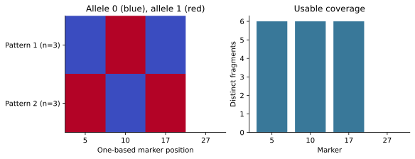

# Read-backed phasing

Two heterozygous sites tell us which alleles are present. A fragment that spans both also tells us which alleles occur on one chromosome copy.

A diploid genotype at each of two sites can be 0/1 in both individuals even if one carries 0–0 and 1–1 and the other carries 0–1 and 1–0. The phase is the ordering across sites on the same copy. Swapping both copy labels within a block changes its name, but preserves every within-block relationship.

[Worked notebook](read_backed_phasing.ipynb) · [Python script](read_backed_phasing.py)

## Phase a known example

Six artificial fragments cover three markers. A fourth marker is present in the variant file and has no spanning observation. Insertions, a deletion and soft clipping test the alignment-coordinate mapping.

## Read the fragment evidence

Each row is one distinct fragment allele pattern. The count in its label shows how many molecules support it. White positions have no observation.

## Recorded output

```text
Position | block | haplotype 1 | haplotype 2 | observed fragments
5   5   0   1   6
10   5   1   0   6
17   5   0   1   6
27   .   .   .   0
Linked markers 3/4 | switch errors 0/2 comparable transitions
```

## Interpreting the result

The unobserved fourth marker has a known genotype and unresolved phase. Phase labels restart at each disconnected block. A switch error compares successive heterozygous sites within the same truth and inferred block.



## Exercise

Lower the support of one link to a tie. Trace how the assignment and the number of comparable transitions change.

## References

[NHGRI, Haplotype](https://www.genome.gov/genetics-glossary/haplotype)

[GA4GH, SAM and VCF specifications](https://samtools.github.io/hts-specs/)

[WhatsHap, read-based phasing](https://whatshap.readthedocs.io/en/latest/guide.html)
